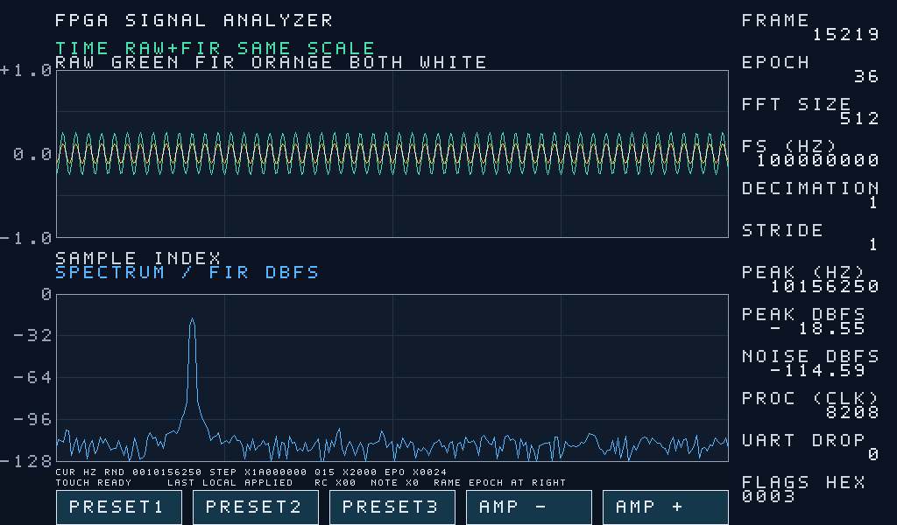

# XC7A35T 实时频谱展示版

基于 XC7A35T 的内部 DDS 信号演示：两路 DDS → 对称 FIR → Hann 加窗 → 512 点 FFT → 时域/频谱绘制。LCD 与 PC 接收同一 FPGA 渲染源的画面；触控和 PC 均可修改参数，并通过 FPGA 实际值、配置版本（epoch）和新图像确认生效。

本仓库是比赛源码与展示入口，从 `up_event_demo_20261101` 冻结交付独立整理，**不包含原私有项目历史**。固定提交标签为 `competition-demo-v1.0`；以该标签下文件提交作品，不引用持续变化的 main。

**验证等级：DEMO_LOOP_VERIFIED，仅限定展示闭环。** 不是外部 ADC 测量仪、整板验收或长期稳定版本。显示的 100 MHz 是设计时钟/内部数值换算参数，不是已经验证的持续采集吞吐；频率数字位数也不是测量准确度。



上图为既有受控演示收到的 FPGA 图像，epoch36、source15219；不是本轮重新拍摄或硬件测试。另有 [基线](docs/images/baseline.png) 和 [触控后](docs/images/touch_applied.png)。

## 硬件和软件

- 已有验证板：正点原子达芬奇 **non-Pro V2.0/V2.1** 引脚方案，器件 `xc7a35tfgg484-2`，YT8531C 千兆 PHY；其他板不能直接套用 XDC。
- 1024×600、7寸 RGB 电容触控屏，已有资料为 ATK-MD0700 V3 系列。冻结 FT 配置只适用于已观察的 `0x38`/版本读数 `0x0001`，不据此断言触控 IC 精确型号或支持所有同名屏。
- FPGA 工具 **Vivado 2023.2**；FFT/VIO 及 XPM/器件原语由合法安装的 AMD 工具提供。本仓库不分发厂商 IP 的生成 RTL、网表、工具或许可密钥。
- PC 已检查环境：Windows、Python **3.13.9**、PySide6 **6.12.0**；Linux/macOS 未运行验收。建议项目虚拟环境，依赖见 requirements 文件。

## 最短软件检查与启动

在仓库根目录运行，无需激活环境或修改 PowerShell 执行策略：

```powershell
py -3.13 -m venv .venv
.venv\Scripts\python.exe -m pip install -r requirements-test.txt
.venv\Scripts\python.exe tools/check.py
.venv\Scripts\python.exe tools/launch_pc.py --offline-check
```

`check.py` 只检查清单/路径和离线软件；测试禁止真实 socket、串口及 EDA 子进程。测试日志写入新临时目录，可用 `--artifacts <目录>` 指定。软件检查不要求板卡、Vivado、管理员权限或真实网络。

实际展示前，由操作者按 [接线与展示步骤](docs/demo-guide.md) 配好同一局域网及板上匹配镜像，再运行：

```powershell
.venv\Scripts\python.exe tools/launch_pc.py --preflight --bind 192.168.10.1 --board 192.168.10.2
.venv\Scripts\python.exe tools/launch_pc.py --bind 192.168.10.1 --board 192.168.10.2
```

也可 `start_pc.cmd --bind ... --board ...`。解释器优先级：`DEMO_PYTHON` → 仓库 `.venv` → PATH 上的 python；地址也可用 `DEMO_BIND`/`DEMO_BOARD`。不依赖原电脑盘符。启动前检查依赖、地址、网卡是否启用及本地 UDP50000/50001 可绑定；不会修改网卡、防火墙或发送探测报文。正式 UI 启动后才与指定板通信。端口检查与启动之间存在竞争窗口，不能保证其他进程不抢占。

**地址参数不会重写 FPGA 的 IP。** 冻结 RTL 使用板 `192.168.10.2`、PC `192.168.10.1` 配置；修改 PC 参数必须与已有固件配置相符。不要将不同网段的旧地址作为该演示的默认源地址。

## 生成 FPGA 工程

```powershell
.venv\Scripts\python.exe tools/prepare_project.py --out E:/fpga_build/spectrum_v1
```

以上只复制冻结输入到新的 ASCII、无空格目录，不启动 Vivado。输出目录已存在则拒绝覆盖。

在已安装 Vivado 2023.2、且另行授权的会话中切换到输出目录并 `source setup.tcl`。该 Tcl 创建工程、加入显式 RTL/XDC/ROM、导入固定 XCI、生成 IP targets、设置 generic 和约束，**不会执行顶层综合、布局布线或导出 bit/LTX**。详细顺序和检查门禁见 [构建说明](docs/build.md)。本轮没有启动 Vivado；静态检查通过不等于完整构建复现通过。

## 一次受控展示

1. 仅开一个 PC 窗口，先等已连接、FPGA 实际值和新图像。触控首次中心轻触再松开后应出现 TOUCH READY；持续 UNAVAILABLE 则停止排查。
2. 轻触一次与当前不同的 PRESET，松开。确认 FPGA 实际 phase/epoch 更新及对应频谱位置变化，不只看按钮状态。
3. PC 修改一次幅度并提交，等待 APPLIED、回读实际值、以及相同配置版本的新图像；确认波形缩小或增大。输入框改变本身不是生效证据。
4. UNKNOWN/FAILED、断连或硬件错误时留证停止，不连续点击、盲目重试、扫描或重新下载。SRAM 镜像断电丢失；没有 Flash 自动恢复功能。

## 已验证与未完成

既有闭环验证一次 PRESET2 与一次 PC 幅度修改：phase `0x08000000→0x1A000000`，epoch `34→35→36`，幅度 `13312→8192`，实际图像由 3.125 MHz 峰移至 10.15625 MHz 后幅度变小。随后冻结 PC 程序约20秒收到568完整帧。完整结果和保留失败边界见 [验证说明](docs/verification.md)。这些是历史实测，本轮只做整理和离线检查。

未完成：M0完整存储架构资源闭合、外部ADC采集、全按钮受控验收、完整生产速率、长稳/耐久、物理CDC和整板验收。UP分支已有短测，最后现场计数0，不能说已实板覆盖UP报文。未来规划外部ADC、完整存储架构、网络缓冲与触控恢复、复杂UI；本次不新增这些功能。

## 目录与来源

| 目录/文件 | 用途 |
|---|---|
| `fpga/source` | 冻结顶层与全部显式 RTL/头文件/约束，保留原层级以稳定引用 |
| `fpga/ip`、`fpga/*.mem` | FFT/VIO配置及四份冻结ROM；工具自行生成厂商IP |
| `fpga/setup.tcl`、`fpga/hub50.xdc` | 同版工程输入、FT配置、调试hub约束 |
| `host` | 冻结PC显示/控制/协议依赖，运行时源码未改 |
| `tools`、`tests` | 便携启动器、工程输入复制器、离线检查与必要软件测试 |
| `evidence`、`docs/images` | 关键结果、失败边界、去除机器身份的报告及真实接收截图 |
| `docs/source-map.json` | 每个移入文件与原冻结/治理源的对应、大小和适配说明 |

[源码映射与整理差异](docs/source-map.md) · [第三方来源](THIRD_PARTY.md) · [许可范围](LICENSE_SCOPE.md)。自有代码采用 MIT；**正点原子衍生驱动保留其原版权，不适用本项目MIT，未核到具体再分发条款**。因此不能把全仓库宣称为统一MIT或已完成第三方许可清权。用户已要求写明此限制后公开。原始私有库的完整历史、研究和失败记录继续保留，公开仓库只收录展示所需部分。
