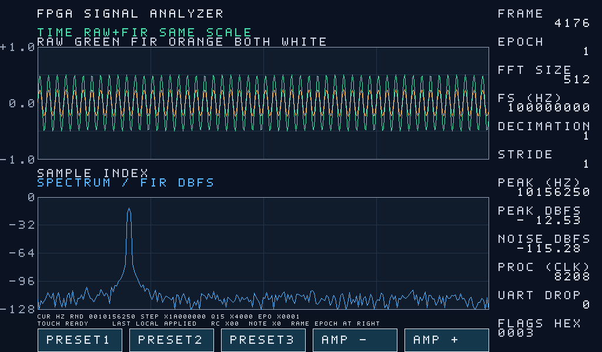
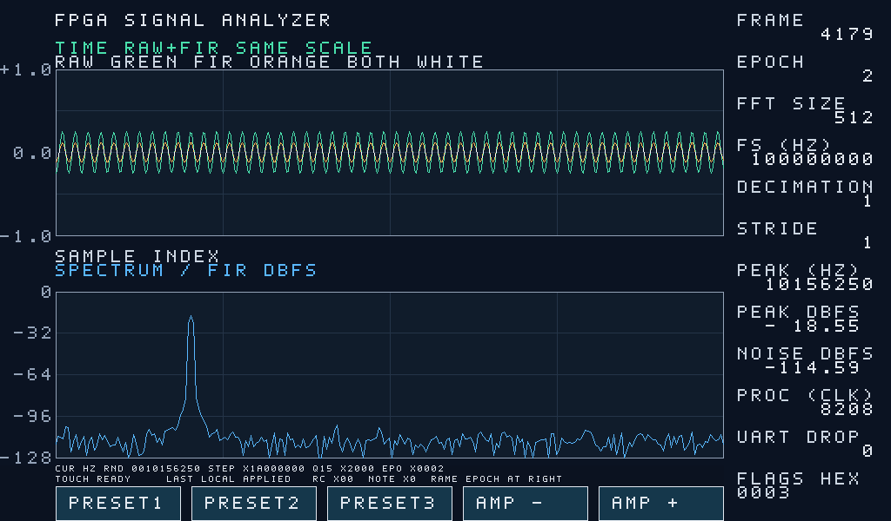

# 2026-11-02 限定展示闭环实验附件

版本 1.0 · 索引编制：2026-11-03 · 维护：项目负责人 / Codex  
原 run：`demo_loop_recheck_20261102_001/interaction001` · 原实验日期：2026-11-02

这是既有实测附件的离线整理，**不是本次重测**。原实验结论 PASS 仅指一次 PRESET2 触控和一次 PC 幅度修改，33.46257 秒、同一会话；不代表 M0、全按钮、长稳、生产速率、电气/物理 CDC 或整板验收。当前硬件电源/SRAM 状态未核。

## 版本、工具与来源

- 冻结设计：`up_event_demo_20261101`；源提交 `f6a248ea18cd723167465bcd67168bee78e77086`；历史使用 `demo_touch_pc_up_event.bit` 及匹配 LTX，无重新综合/实现。本包不另行发布 bit/LTX。
- 对应公开源码基点：`competition-demo-v1.0` / `16a85aa0bcdf2c26bf02d17e1c35025fa30bb31b`；历史记录核对 10 份 PC 运行源与冻结版逐字一致。
- 历史 FPGA 工具：Vivado 2023.2；PC 公开版环境说明为 Windows / Python3.13.9 / PySide6 6.12.0。原本次 run 没有单独冻结完整环境依赖清单，不能冒充跨机复现。
- 来源存放：采集电脑本机 `ethernet-runs/demo_loop_recheck_20261102_001`；公开附件相对来源逐项列于 [attachments.json](attachments.json)。不含来源电脑身份、JTAG 序列号和绝对个人路径。
- 已复制 **16 份**原始文件，字节未改：metrics 1 份、interaction JSON 11 份、PNG 4 份。JSON 的 token/session 是已结束的 UDP 演示会话关联标识，不是账号登录凭据。原运行脚本、完整 EDA/MCP 日志、原报告及硬件预检原件继续保留本机；这里不是全量自包含重跑包。
- 初始“未发现调试核”及后续一次 SRAM 下载的历史边界见 [硬件前置记录摘录](hardware-history-excerpt.json)。该文件是明确选择字段的派生件，未把原警告改 PASS；不公开板序列号/厂商核 UUID 等机器标识。没有 Flash 操作或本次硬件动作。

## 报告主张与原始依据

| 阶段 | DDS phase / Q15 幅度 | epoch / 图像 source | 原始状态与图像 |
|---|---|---|---|
| 基线 | 431174451 / 16384 | 0 / 3194 | [baseline.json](interaction001/baseline.json)、[baseline.png](interaction001/baseline.png) |
| 触控 PRESET2 | 436207616 / 16384 | 1 / 4176 | [touch_applied.json](interaction001/touch_applied.json)、[touch_applied.png](interaction001/touch_applied.png) |
| PC 调幅 | 436207616 / 8192 | 2 / 4179 | [pc_applied.json](interaction001/pc_applied.json)、[pc_applied.png](interaction001/pc_applied.png) |

配置时钟参数100MHz，`phase/2^32*100000000` 换算基线约10.03906249MHz，触控后10.15625MHz。它是 DDS 配置换算，不能等同外部测频准确度；基线截图 FFT 估峰约10.041398MHz，与参数换算是不同观测量。

同频比较触控后与 PC 后的幅度：16384→8192，截图频谱峰显示−12.53→−18.55dBFS，显示差−6.02dB；理论 `20log10(8192/16384)=-6.0206dB`。这些显示值可目视核对对应 PNG；**不是 metrics.json 中存储的数值，也不是独立外部仪器精度测量**。不要改用不同频率的 baseline.png（峰−11.97dBFS）作该对照。

## 单次主机时序

[唯一 submissions](interaction001/submissions.json)、[result.json](interaction001/result.json) 的 receipt、[pc_applied.json](interaction001/pc_applied.json) 的 state/metadata 可复算 [metrics.json](metrics.json)：

| 事件 | 同一主机单调时钟 / 秒 | 从提交起累计毫秒 |
|---|---:|---:|
| 接受唯一 PC 提交 | 193838.8757665 | 0 |
| 收到 ACK / write_receipt | 193838.9041230 | 28.3565 |
| INFO actual_at | 193838.9045356 | 28.7691 |
| epoch2 图像 metadata[4] | 193838.9682954 | 92.5289 |

四个时间取同一受控写入和会话；不是把 ACK/INFO/图像三段累计值相加。样本量 **n=1**，包含主机接收/软件调度和 GUI；不能证明触控物理时延、FPGA 纯处理耗时、硬实时上界或统计分布。

## 完整性、帧计数与失败边界

- [states.json](interaction001/states.json)：69 条状态观察；[event-log.json](interaction001/event-log.json)：141 条事件，含结束后 disconnected/stopped。正常收尾后的断连不倒写成活动测试失败。
- [image-metadata.json](interaction001/image-metadata.json)：946 条图像回调记录。它与 GUI 的完整帧计数是不同层，不能宣称日志覆盖每个接收帧。
- [pc-window.png](interaction001/pc-window.png)：最终 GUI 完整帧964、丢弃帧1。不是零丢包证明，也不将应用丢弃数当线缆丢包率或据此外推持续吞吐。
- [send-evidence.json](interaction001/send-evidence.json)：104 条历史发送证据；只是原始记录，不作为运行命令，不新增任何网络流量。
- [touch-result.json](interaction001/touch-result.json)、[progress.json](interaction001/progress.json)、[result.json](interaction001/result.json)：原始进度、动作关联与完成结果。触控关联用户动作、INFO 和图像，不声称拥有内部触控事务 ID。
- 原预检 warning 与既有旧失败都保留，详见派生硬件摘要及 [原验证说明](../../docs/verification.md)。没有把历史失败抹掉或恢复 SKIPPED_BY_USER 的长测。

## 与 11 月 1 日附件区分

原 [interaction003](../interaction003/result.json) 是11月1日 epoch34→35→36、幅度13312→8192、图像source14103/15215/15219；本目录为11月2日 epoch0→1→2、幅度16384→8192、source3194/4176/4179。不同 run 的短目录名不构成同一实验。旧20.115秒568帧的 [观察](../delivery-observe001/result.json) 也是独立窗口，不能与本次964帧合并计算。

最新参赛报告参考文献[6]应以本目录定位新数据；旧固定标签尚不含本目录。后续正式提交应明确实际补充版本，不移动原标签。更多导航见 [报告配套索引](../../report/README.md)。
